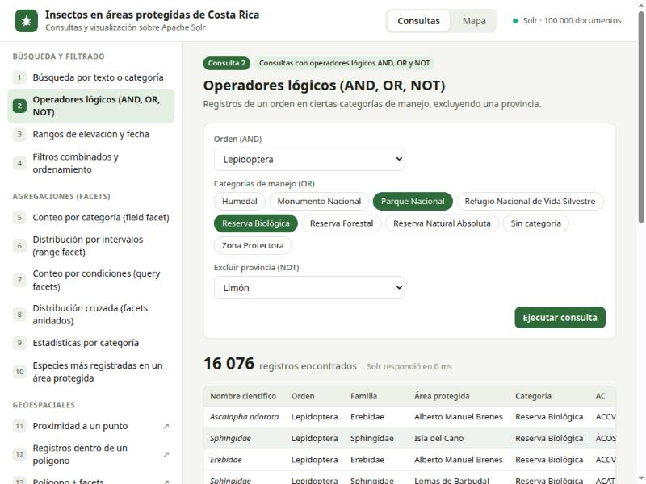
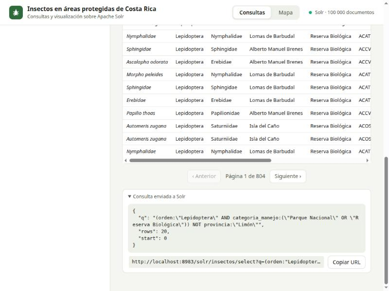
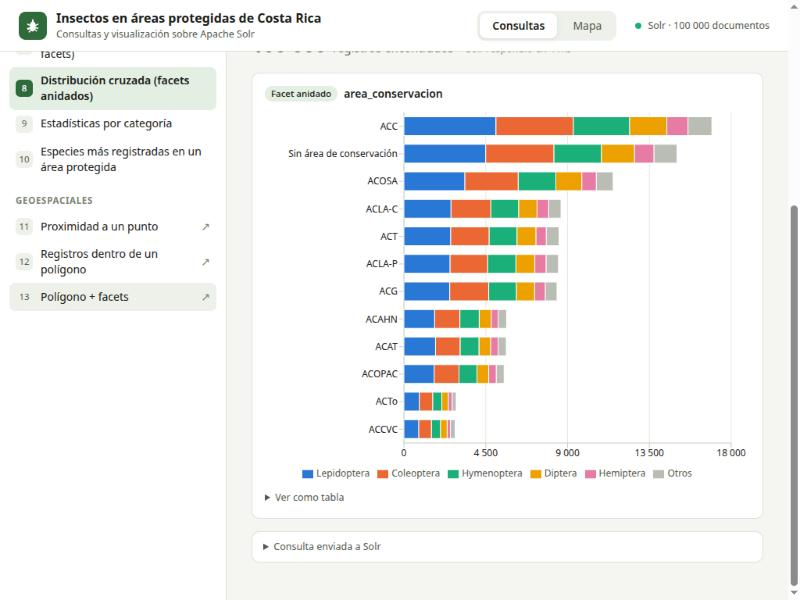
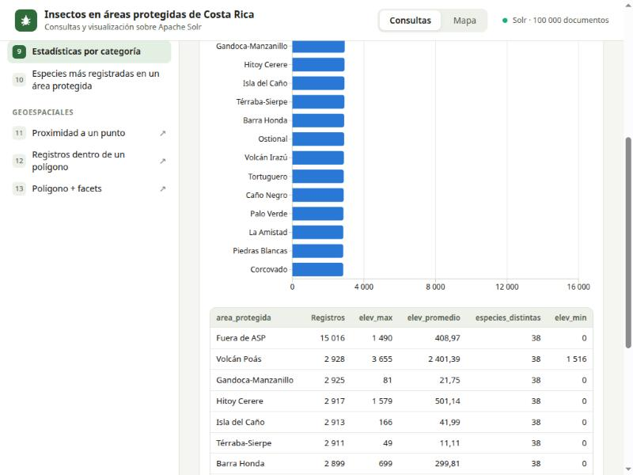
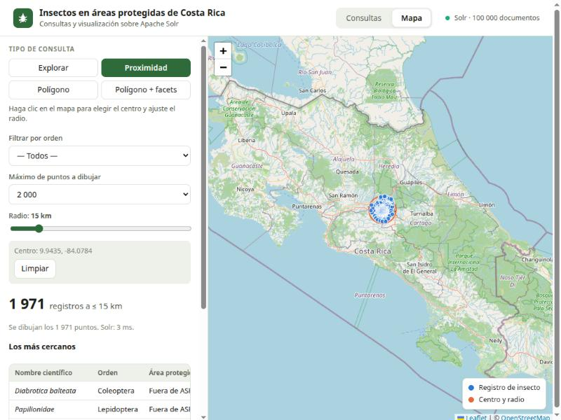
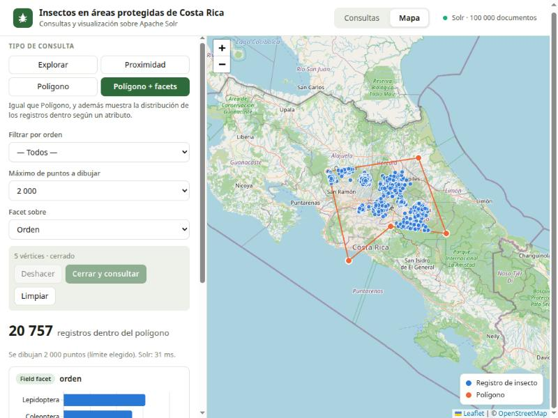

# Documentación de la aplicación — Etapa 2

**Proyecto:** Investigar y analizar la población de insectos en áreas protegidas de Costa Rica.
**Etapa 2:** Aplicación de consultas y visualización sobre Apache Solr.

> **Nota sobre los datos.** Las capturas y cifras de este documento se obtuvieron con el
> dataset **sintético** de 100 000 registros (`datos/generar_muestra.py`), que tiene el mismo
> esquema que la salida del notebook de Spark: áreas protegidas y taxones reales, con
> coordenadas, fechas y elevaciones aleatorias. Las cifras sirven para comprobar que las
> consultas funcionan, **no son hallazgos sobre los insectos de Costa Rica**. Al indexar el
> dataset real basta con volver a ejecutar las consultas y actualizar las capturas
> (ver [§7](#7-recomendaciones)).

## Contenido
1. [Tecnologías utilizadas](#1-tecnologías-utilizadas)
2. [Arquitectura y comunicación con Apache Solr](#2-arquitectura-y-comunicación-con-apache-solr)
3. [Configuración e indexación en Solr](#3-configuración-e-indexación-en-solr)
4. [Las consultas y cómo apoyan el objetivo del proyecto](#4-las-consultas-y-cómo-apoyan-el-objetivo-del-proyecto)
5. [Consultas geoespaciales a partir del polígono dibujado](#5-consultas-geoespaciales-a-partir-del-polígono-dibujado)
6. [Pruebas realizadas y resultados](#6-pruebas-realizadas-y-resultados)
7. [Conclusiones y recomendaciones](#7-conclusiones-y-recomendaciones)

---

## 1. Tecnologías utilizadas

| Capa | Tecnología | Versión | Para qué se usa |
|---|---|---|---|
| Motor de búsqueda | **Apache Solr** (imagen oficial de Docker) | 9.7 | Índice, consultas, facets y filtros espaciales |
| Geometría | **JTS Topology Suite** (`jts-core`) | 1.19.0 | Permite que Solr acepte polígonos arbitrarios (WKT) |
| Contenedores | **Docker Compose** | — | Levanta Solr con el core `insectos` y la librería JTS |
| Backend | **Python** + **FastAPI** + **Uvicorn** | 3.12 / 0.115 / 0.34 | API REST entre la interfaz y Solr |
| Cliente HTTP | **httpx** | 0.28 | Envío de consultas a Solr |
| Pruebas | **pytest** | 8.3 | 22 pruebas automáticas contra el Solr real |
| Frontend | **React** + **Vite** | 18.3 / 5.4 | Interfaz gráfica de una sola página |
| Mapa | **Leaflet** + **react-leaflet** (teselas de OpenStreetMap) | 1.9 / 4.2 | Mapa interactivo, puntos y dibujo de polígonos |
| Gráficos | **Recharts** | 2.13 | Barras, histogramas, barras apiladas |

**Por qué estas tecnologías:**
- **FastAPI** valida automáticamente los datos que llegan de la interfaz (por ejemplo, que
  la latitud esté entre −90 y 90) y genera documentación interactiva en `/docs`.
- **React** permite armar los formularios a partir de una descripción de cada consulta,
  sin escribir una pantalla por consulta.
- **Leaflet** es liviano y usa renderizado en *canvas*, lo que permite dibujar miles de
  puntos sin que el mapa se vuelva lento.

---

## 2. Arquitectura y comunicación con Apache Solr

```
┌──────────────────────┐   JSON    ┌──────────────────────────┐  HTTP (form)  ┌─────────────────┐
│  Navegador (React)   │ ────────▶ │  API FastAPI (Python)    │ ────────────▶ │  Apache Solr    │
│  · Consultas         │           │  · main.py   (rutas)     │               │  core «insectos»│
│  · Mapa (Leaflet)    │ ◀──────── │  · consultas/ (arma los  │ ◀──────────── │  /select        │
│                      │   JSON    │    parámetros de Solr)   │     JSON      │                 │
└──────────────────────┘           │  · solr.py  (envía y     │               └─────────────────┘
                                   │    normaliza)            │
                                   └──────────────────────────┘
```

### Flujo de una consulta (ejemplo: consulta 2)

1. **Formulario.** Al abrir la aplicación, la interfaz pide:
   - `GET /api/catalogo`: la descripción de las 13 consultas (campos del formulario,
     valores por defecto, tipo de gráfico), definida en `backend/app/catalogo.py`.
   - `GET /api/opciones`: los valores reales de los menús (órdenes, provincias, áreas…).
     La API los obtiene con un *field facet* a Solr, así los menús solo ofrecen valores
     que existen en el índice.
2. **Envío.** Al ejecutar, la interfaz manda lo que eligió el usuario:
   ```http
   POST /api/consultas/2
   {"parametros": {"orden": "Lepidoptera",
                   "categorias": ["Parque Nacional", "Reserva Biológica"],
                   "excluir_provincia": "Limón"},
    "pagina": 0, "filas": 20}
   ```
3. **Construcción.** La API llama a la función de esa consulta
   (`backend/app/consultas/convencionales.py` o `geoespaciales.py`). Cada función recibe
   los valores del formulario y **devuelve un diccionario con los parámetros de Solr**:
   ```python
   {"q": '(orden:"Lepidoptera" AND categoria_manejo:("Parque Nacional" OR "Reserva Biológica")) NOT provincia:"Limón"'}
   ```
   La API agrega la paginación (`rows`, `start`).
4. **Ejecución.** `backend/app/solr.py` envía los parámetros a
   `http://localhost:8983/solr/insectos/select` por `POST` con
   `application/x-www-form-urlencoded`. Se usa POST para que los polígonos con muchos
   vértices no excedan el largo máximo de una URL.
5. **Normalización.** Solr responde con estructuras distintas según el tipo de facet
   (`facet_fields`, `facet_ranges`, `facet_queries`, `facets` de la JSON Facet API…).
   `solr.py` las convierte a un formato único:
   ```json
   {"numFound": 16076, "docs": [...], "qtime": 3,
    "facets": [{"nombre": "...", "tipo": "campo|rango|consulta|json",
                "buckets": [{"valor": "...", "conteo": 0, "metricas": {}, "hijos": []}]}],
    "solr_params": {...}, "solr_url": "http://localhost:8983/solr/insectos/select?..."}
   ```
6. **Visualización.** La interfaz muestra el total, la tabla paginada, el gráfico del
   facet y el panel **«Consulta enviada a Solr»**, con los parámetros exactos y la URL
   equivalente. Esa URL se puede pegar en el navegador y Solr devuelve el mismo resultado.





### Rutas de la API

| Método y ruta | Descripción |
|---|---|
| `GET /api/estado` | Conexión con Solr y cantidad de documentos (indicador del encabezado) |
| `GET /api/catalogo` | Consultas disponibles y sus formularios |
| `GET /api/opciones` | Valores de los menús desplegables |
| `POST /api/consultas/{1..10}` | Ejecuta una consulta convencional |
| `GET /api/mapa/puntos` | Muestra aleatoria de puntos para el modo «Explorar» del mapa |
| `POST /api/geo/proximidad` | Consulta 11 |
| `POST /api/geo/poligono` | Consulta 12 |
| `POST /api/geo/poligono-facets` | Consulta 13 |

Si Solr devuelve un error (por ejemplo, de sintaxis), la API responde con el mismo código
HTTP y el mensaje de Solr, y la interfaz lo muestra junto con la consulta que lo causó.

---

## 3. Configuración e indexación en Solr

### Contenedor

`docker-compose.yml` levanta un único nodo de Solr 9.7:
- Se construye desde `solr/Dockerfile`, que parte de `solr:9.7` y descarga
  `jts-core-1.19.0.jar` de Maven Central a `/opt/solr/server/solr-webapp/webapp/WEB-INF/lib/`.
  La imagen oficial no trae JTS, y sin esa librería Solr no puede crear el campo espacial.
- `solr-precreate insectos` crea el core al arrancar.
- El puerto 8983 se publica solo en `127.0.0.1`.
- El volumen `solr_data` (`/var/solr`) conserva el índice entre reinicios.

### Esquema

`solr/crear_esquema.py` define el esquema mediante la **Schema API**. Desactiva la
creación automática de campos (`update.autoCreateFields=false`) y agrega cada campo con su
tipo. Un documento corresponde a una ocurrencia de insecto ya unida con su área protegida.

| Campo | Tipo | Uso en las consultas |
|---|---|---|
| `nombre_cientifico`, `localidad` | `text_general` (analizado) | Búsqueda por palabras (consulta 1) |
| `texto` | `text_es`, por `copyField` de nombre, orden, familia, localidad, área y categoría | Búsqueda general en español |
| `orden`, `familia`, `genero`, `especie`, `provincia`, `area_protegida`, `categoria_manejo`, `area_conservacion`, `estacion`, `piso_altitudinal`, … | `string` con docValues | Filtros exactos y facets |
| `elevacion_m`, `latitud`, `longitud`, `area_protegida_km2` | `pdouble` | Rangos, estadísticas |
| `anio`, `mes` | `pint` | Range facet por año |
| `fecha_evento` | `pdate` | Rangos temporales y orden |
| `dentro_asp` | `boolean` | Query facets |
| **`ubicacion`** | **`ubicacion_rpt`** | Consultas geoespaciales |

El tipo **`ubicacion_rpt`** es un `SpatialRecursivePrefixTreeFieldType` con:
- `spatialContextFactory=JTS`: acepta polígonos arbitrarios en formato WKT, no solo
  rectángulos ni círculos.
- `geo=true` y `distanceUnits=kilometers`: coordenadas geográficas y distancias en km.
- `distErrPct=0`: precisión exacta en los bordes. Con el valor por defecto (0,025),
  Solr aproxima la forma del polígono y llegaba a incluir puntos que estaban justo afuera.
- `validationRule=repairBuffer0`: repara polígonos inválidos, como uno dibujado con
  lados que se cruzan.

### Indexación

`solr/indexar.py` lee el archivo JSONL o CSV que produce Spark y lo envía en lotes de
5 000 documentos a `/update`, con un *commit* al final. Si el campo `ubicacion` no viene,
lo construye como `"lat,lon"`. Los 100 000 documentos de prueba se indexan en unos 7 s.

---

## 4. Las consultas y cómo apoyan el objetivo del proyecto

El objetivo es **analizar la población de insectos en las áreas silvestres protegidas
(ASP)**. Para eso las consultas responden tres tipos de preguntas: *¿dónde?* (áreas,
regiones, cercanía), *¿qué?* (qué órdenes y especies) y *¿en qué condiciones?*
(elevación, época, estación).

En la tabla, **«Ejemplo»** es la consulta que arma la aplicación con los valores por
defecto del formulario, y **«Resultado»** lo que devolvió Solr con los datos de prueba.

### a. Búsqueda y filtrado

| # | Requisito | Ejemplo (parámetros de Solr) | Resultado | Pregunta que responde |
|---|---|---|---|---|
| 1 | Búsqueda por campos textuales o categóricos | `q=Morpho&defType=edismax&qf=texto&q.op=AND`. En campos exactos: `fq=area_protegida:"Volcán Poás"` | 1 204 / 2 928 | ¿Dónde se ha registrado un taxón? ¿Qué hay registrado en un área? |
| 2 | Operadores AND, OR y NOT | `q=(orden:"Lepidoptera" AND categoria_manejo:("Parque Nacional" OR "Reserva Biológica")) NOT provincia:"Limón"` | 16 076 | ¿Cuántas mariposas hay en las categorías de protección más estrictas, fuera del Caribe? |
| 3 | Rangos numéricos y temporales | `fq=elevacion_m:[1000 TO 2500]`, `fq=fecha_evento:[1995-01-01T00:00:00Z TO 2005-12-31T23:59:59.999Z]` | 11 968 | ¿Qué se colectó en zonas de montaña durante un periodo? |
| 4 | Combinación de filtros y ordenamiento por varios atributos | `fq=orden:"Coleoptera"`, `fq=area_conservacion:"ACOSA"`, `sort=fecha_evento desc, elevacion_m asc, id asc` | 2 935 | Registros más recientes de escarabajos en el Área de Conservación Osa |

**Decisiones de diseño:**
- En la consulta 2 la expresión va completa en `q` para que los tres operadores se vean en
  una sola expresión booleana.
- En la 3 y la 4 cada condición es un `fq` aparte: son filtros de sí/no que no afectan la
  relevancia, y Solr guarda cada uno en caché por separado.
- Un filtro opcional que se deja vacío no restringe la búsqueda.
- Los valores elegidos por el usuario se ponen entre comillas y se escapan.
- Los nombres de campo y de orden se validan contra una lista de permitidos, para que nadie
  pueda inyectar sintaxis de Solr.

### b. Facets

| # | Requisito | Ejemplo (parámetros de Solr) | Resultado | Pregunta que responde |
|---|---|---|---|---|
| 5 | Field facet | `facet.field=orden&facet.limit=10&facet.mincount=1&facet.sort=count` | Lepidoptera 29 909, Coleoptera 25 010, Hymenoptera 17 997… | ¿Qué órdenes dominan los registros? (también por área, provincia, categoría…) |
| 6 | Range facet | `facet.range=elevacion_m&facet.range.start=0&facet.range.end=3500&facet.range.gap=250&facet.range.other=all` | [0, 250): 46 645; [250, 500): 11 459… | ¿Cómo se distribuyen los registros según la elevación, o según el año? |
| 7 | Query facets | 8 `facet.query` con nombre, por ejemplo `{!key='Piso basal (< 500 m)'}elevacion_m:[* TO 500}` o `dentro_asp:true` | Basal 58 104, Premontano 25 459, Montano bajo 8 966… | ¿Cuántos registros hay por piso altitudinal, dentro o fuera de un ASP y por estación? |
| 8 | Facets anidados | `json.facet`: `terms` de `area_conservacion` (12) con un `terms` de `orden` (5) en cada bucket | ACC 16 931 (5 órdenes)… | ¿Qué órdenes predominan en cada área de conservación? |
| 9 | Facets con funciones estadísticas | `json.facet`: `terms` de `area_protegida` con `avg`, `min` y `max(elevacion_m)` y `unique(especie)` | Volcán Poás: 2 928 registros, elevación de 1 516 a 3 655 m, promedio 2 401 m | Perfil altitudinal y riqueza de especies de cada área |
| 10 | Field facet filtrado + estadísticas | `fq=area_protegida:"Corcovado"` + `terms` de `especie` + `avg`, `min`, `max` y `unique` globales | 2 841 registros; *Polybia occidentalis* 108, *Calosoma sayi* 95… | ¿Cuáles son las especies más registradas en un área protegida? |

**Decisiones de diseño:**
- En la consulta 7, los rangos de elevación usan `}` (extremo exclusivo) para que ningún
  registro caiga en dos pisos.
- Para la consulta 8 se eligió la **JSON Facet API** en lugar de `facet.pivot` porque
  permite un límite distinto en cada nivel. Además es la misma API que se usa para las
  métricas de la 9 y la 10.
- La consulta 10 cuenta sobre `especie`, así que solo incluye los registros identificados
  hasta especie. Los identificados solo hasta género o familia no entran en el ranking.





### c. Geoespaciales

| # | Requisito | Ejemplo (parámetros de Solr) | Resultado | Pregunta que responde |
|---|---|---|---|---|
| 11 | Proximidad con radio del usuario (+ filtro por atributo) | `sfield=ubicacion&pt=9.93,-84.08&d=15&fq={!geofilt}&sort=geodist() asc&fl=…,dist:geodist()` y, si se elige un orden, `fq=orden:"Lepidoptera"` | 1 951 (579 Lepidoptera) | ¿Qué se ha registrado cerca de un punto, como una estación biológica o un sendero? |
| 12 | Registros dentro de una región dibujada | `fq=ubicacion:"Intersects(POLYGON((-83.75 8.75, -83.3 8.7, -83.25 8.45, -83.55 8.35, -83.8 8.5, -83.75 8.75)))"` | 2 912 (península de Osa) | ¿Qué hay en una región que no coincide con los límites administrativos, como un corredor biológico? |
| 13 | Polígono combinado con facets | Mismo `fq` + `facet.field=orden&facet.mincount=1&facet.limit=-1` | Lepidoptera 848, Coleoptera 747, Hymenoptera 532… | ¿Cómo se compone la población de insectos dentro de esa región? |



---

## 5. Consultas geoespaciales a partir del polígono dibujado

El mapa (pestaña **Mapa**) tiene cuatro modos: *Explorar*, *Proximidad*, *Polígono* y
*Polígono + facets*.

### Procedimiento

1. **Dibujo libre.** En el modo *Polígono*, cada clic sobre el mapa agrega un vértice.
   No hay límite de vértices y el polígono puede ser irregular o cóncavo.
   - **Deshacer** quita el último vértice.
   - **Limpiar** empieza de nuevo.
   - **Cerrar y consultar**, o un clic sobre el primer vértice, cierra el polígono.
2. **Envío.** La interfaz manda los vértices en el orden en que se dibujaron, como
   `[lat, lon]` (el orden que usa Leaflet), junto con los filtros por atributo y el máximo
   de puntos a dibujar (vértices de ejemplo):
   ```http
   POST /api/geo/poligono-facets
   {"vertices": [[10.05,-84.40],[10.10,-83.95],[9.85,-83.85],[9.87,-84.08],[9.75,-84.25]],
    "filtros": {"orden": "Lepidoptera"}, "filas": 2000, "campo_facet": "orden"}
   ```
   La API valida que haya al menos 3 vértices y que las coordenadas estén en rango.
3. **Construcción del WKT.** La función `poligono_wkt()` de
   `backend/app/consultas/geoespaciales.py`:
   - invierte cada vértice a **`lon lat`**, porque WKT usa el orden *x y*;
   - quita el último vértice si es igual al primero, para no duplicarlo;
   - exige al menos 3 vértices distintos;
   - **cierra el anillo** repitiendo el primer vértice al final.

   Resultado: `POLYGON((-84.4 10.05, -83.95 10.1, -83.85 9.85, -84.08 9.87, -84.25 9.75, -84.4 10.05))`
4. **Filtro en Solr.** El polígono viaja dentro de un `fq` sobre el campo RPT:
   ```
   fq=ubicacion:"Intersects(POLYGON((...)))"
   fq=orden:"Lepidoptera"            ← condición sobre otro atributo (opcional)
   facet.field=orden                 ← solo en el modo «Polígono + facets»
   ```
   Para puntos, `Intersects` e `IsWithin` dan el mismo resultado. Se usa `Intersects`
   porque es la operación recomendada, es más barata e incluye los puntos sobre el borde.
   Solr resuelve el filtro con el índice espacial (árbol de prefijos) y la geometría de JTS.
5. **Resultado.** La interfaz:
   - borra los puntos anteriores y dibuja **solo los documentos que devolvió Solr**;
   - muestra el total `numFound` («20 757 registros dentro del polígono»), aunque se dibuje
     una cantidad menor de puntos;
   - en el modo con facets, muestra debajo el gráfico de distribución por el campo elegido.

**El filtrado lo hace Solr, no la aplicación.** El backend nunca pide todos los registros
para filtrarlos en Python: el polígono se envía dentro del `fq`. Esto se puede verificar en
el panel «Consulta enviada a Solr», y una prueba automática (§6) comprueba que la consulta
enviada contiene el `POLYGON`.



### Proximidad

En el modo *Proximidad*, un clic fija el centro y un deslizador elige el radio (1–100 km).
La consulta se repite sola 250 ms después de cada cambio. Los parámetros compartidos
`sfield`, `pt` y `d` los usan a la vez tres partes de la consulta:
- `{!geofilt}`: el filtro por distancia;
- `geodist()`: el orden, del más cercano al más lejano;
- el campo calculado `dist`: la distancia de cada registro en km, que se muestra en la tabla.

---

## 6. Pruebas realizadas y resultados

### Pruebas automáticas

Ubicadas en `backend/tests/`. Se ejecutan contra el Solr real con:

```bash
backend/.venv/bin/pytest backend/tests -v
```

Las pruebas **no comparan la consulta escrita**, sino que **el resultado tenga sentido**.
En las geoespaciales, la geometría se recalcula en Python de forma independiente a Solr.

| Prueba | Qué verifica |
|---|---|
| `test_consulta_1_*` (3) | Búsqueda general, coincidencia exacta y valores con espacios («Volcán Poás») |
| `test_consulta_2_logicos` | Todo documento cumple el orden, alguna de las categorías y no está en la provincia excluida |
| `test_consulta_3_rangos` | Todas las elevaciones y fechas están dentro de los rangos |
| `test_consulta_4_filtros_y_orden` | Se cumplen los filtros y el orden (fecha desc, luego elevación asc) |
| `test_consulta_4_filtros_vacios_no_filtran` | Con filtros vacíos, `numFound` es igual al total del índice |
| `test_consulta_5_field_facet` | Respeta el límite y ordena los buckets de mayor a menor |
| `test_consulta_6_*` (2) | Los intervalos empiezan en 0, 500, 1000… (7 buckets) y en 1985, 1990… por año |
| `test_consulta_7_query_facets` | Al menos 3 condiciones con conteo |
| `test_consulta_8_anidado` | Cada bucket tiene un segundo nivel, respeta los límites y los hijos no superan al padre |
| `test_consulta_9_estadisticas` | Cada grupo trae al menos 3 métricas |
| `test_consulta_10_ranking` | Son especies (género + epíteto) y los conteos no superan el total del área |
| `test_consulta_11_proximidad` | Distancia de Haversine de cada punto ≤ radio, y resultados del más cercano al más lejano |
| `test_consulta_11_con_filtro` | El filtro por orden reduce el resultado y todos los documentos son de ese orden |
| `test_consulta_12_poligono` | Cada punto devuelto está dentro del polígono según *ray casting* en Python, y la consulta enviada contiene `POLYGON` |
| `test_consulta_12_poligono_cerrado_o_no` | Enviar el polígono abierto o cerrado da el mismo total |
| `test_consulta_13_poligono_facets` | La suma de los buckets es igual al total dentro del polígono |
| `test_normalizacion.py` (3) | Conversión de parámetros y normalización de cada tipo de facet, sin necesitar Solr |

**Resultado:** `22 passed` (las 22 pruebas pasan).

### Pruebas manuales en la interfaz

| Prueba | Resultado |
|---|---|
| Ejecutar las consultas 1–10 con los valores por defecto | Totales coinciden con los de la tabla de §4; los gráficos se dibujan sin errores en la consola |
| Abrir directamente en Solr la URL del panel «Consulta enviada a Solr» (consulta 2) | Mismo `numFound` (16 076) |
| Dibujar un polígono cóncavo de 5 vértices sobre el Valle Central (modo polígono + facets) | 20 757 registros, solo se dibujan puntos interiores, gráfico por orden |
| Proximidad con un clic cerca de San José, radio de 15 km | 1 971 registros dentro del círculo, tabla con los más cercanos |
| Polígono con lados cruzados (forma de 8) | Solr lo repara (`repairBuffer0`) y responde (4 244 registros); no hay error |
| Reiniciar el contenedor (`docker compose restart`) | El índice conserva los 100 000 documentos |
| Ventanas de 1 009 px y de 375 px (celular) | Sin desplazamiento horizontal de la página: las tablas anchas se desplazan dentro de su recuadro |

---

## 7. Conclusiones y recomendaciones

### Conclusiones

- **Solr cubre todo el análisis.** Búsqueda, filtros, cinco tipos de facets, estadísticas
  y geometría se resuelven en el índice, con tiempos de respuesta de pocos milisegundos
  sobre 100 000 documentos. La aplicación solo arma la consulta y presenta el resultado.
- **El campo espacial requiere configuración explícita.** Para consultar polígonos
  arbitrarios hacen falta tres cosas que no vienen por defecto: la librería JTS en la
  imagen, `spatialContextFactory=JTS` y `distErrPct=0`. Sin la última, el filtro aceptaba
  puntos fuera del borde del polígono.
- **Separar la construcción de la consulta de su ejecución** hizo posible probar cada
  consulta de forma aislada. Cada función solo devuelve parámetros, y el panel «Consulta
  enviada a Solr» hace visible qué se ejecuta en cada momento.
- **Para el objetivo del proyecto**, la combinación más útil es el polígono con facets
  (consulta 13). Permite delimitar una región que no coincide con los límites oficiales,
  como un corredor biológico o una cuenca, y ver de inmediato cómo se compone su población
  de insectos.

### Recomendaciones

1. **Reemplazar los datos de prueba** por la salida del notebook de Spark:
   ```bash
   backend/.venv/bin/python solr/indexar.py ruta/al/archivo_de_spark.jsonl --borrar
   ```
   Si cambia algún nombre de campo, ajustar `solr/crear_esquema.py` y
   `backend/app/catalogo.py`. Después, volver a tomar las capturas y actualizar las cifras
   de este documento.
2. **Indexar los polígonos reales de las ASP del SINAC** en un core aparte. Así se podría
   elegir un área en el mapa y usar su geometría oficial como filtro, en lugar de dibujarla.
3. **Agregar más filtros por atributo al mapa**, como área protegida o rango de fechas. El
   diccionario `filtros` ya está preparado para recibir más claves.
4. **Para volúmenes grandes** (los 3,27 millones de registros de GBIF): agrupar puntos en el
   mapa con un *heatmap facet* de Solr (`facet.heatmap`) en lugar de dibujar puntos
   individuales, y evaluar SolrCloud con réplicas si la carga lo justifica.
5. **Seguridad en producción:** Solr no tiene autenticación en esta configuración y por eso
   solo escucha en `127.0.0.1`. Si se publica, habilitar el plugin de autenticación de Solr
   y dejar el acceso a Solr solo a través de la API.
